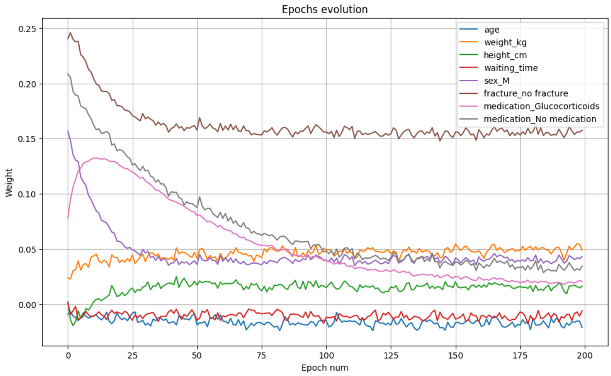

# Bone Mineral Density Prediction

## Linear Regression and Gradient-Based Weight Analysis

This project applies linear regression techniques to predict **bone mineral density (BMD)** from patient characteristics. It covers preprocessing of numerical and categorical variables, evaluation of a linear regression model using multiple error metrics, and analysis of coefficient convergence during gradient-based optimization.

## Problem Definition

Bone mineral density is an important clinical measurement related to bone strength and fracture risk. The objective of this project is to estimate a patient's BMD value from the available demographic and medical attributes.

The prediction task is formulated as a **supervised regression problem**, where the continuous target variable is `bmd`.

## Dataset

The dataset contains patient information represented by the following input variables:

| Feature | Type | Description |
|---|---|---|
| `age` | Numerical | Patient age |
| `weight_kg` | Numerical | Patient weight in kilograms |
| `height_cm` | Numerical | Patient height in centimeters |
| `waiting_time` | Numerical | Recorded waiting-time value |
| `sex` | Categorical | Patient sex |
| `fracture` | Categorical | Fracture-history category |
| `medication` | Categorical | Medication category |
| `bmd` | Continuous target | Bone mineral density value |

The feature matrix is created by removing the `bmd` column from the dataset, while `bmd` is retained as the regression target.

## Data Preparation

The data is divided into training and test subsets using `train_test_split`. A `ColumnTransformer` applies separate preprocessing procedures to numerical and categorical attributes.

### Numerical Features

The following numerical features are standardized using `StandardScaler`:

- `age`
- `weight_kg`
- `height_cm`
- `waiting_time`

Standardization transforms the features to comparable scales, which is particularly important for the later gradient-based coefficient analysis.

### Categorical Features

The categorical variables are converted into numerical indicator columns using `OneHotEncoder`:

- `sex`
- `fracture`
- `medication`

The encoder uses `drop='first'`, removing one category from each feature to avoid redundant dummy variables.

## Linear Regression Model

The preprocessing transformer and `LinearRegression` estimator are combined in a Scikit-learn `Pipeline`. This allows preprocessing and regression to be applied as one consistent workflow.

After fitting the pipeline on the training data, BMD values are predicted for the test set.

## Evaluation Metrics

The regression model is evaluated using three complementary error metrics.

### Mean Squared Error

Mean Squared Error measures the average squared difference between the actual and predicted values:

$$
\operatorname{MSE}=\frac{1}{n}\sum_{i=1}^{n}(y_i-\hat{y}_i)^2
$$

Because errors are squared, larger prediction errors receive a greater penalty.

### Root Mean Squared Error

Root Mean Squared Error is the square root of MSE:

$$
\operatorname{RMSE}=\sqrt{\frac{1}{n}\sum_{i=1}^{n}(y_i-\hat{y}_i)^2}
$$

RMSE is expressed in the same unit as the target variable, making the magnitude of the prediction error easier to interpret while retaining sensitivity to larger errors.

### Mean Absolute Error

Mean Absolute Error measures the average absolute difference between predicted and observed values:

$$
\operatorname{MAE}=\frac{1}{n}\sum_{i=1}^{n}|y_i-\hat{y}_i|
$$

Unlike MSE and RMSE, MAE does not square individual errors and is therefore less strongly influenced by unusually large prediction errors.

## Linear Regression Results

The most recent saved Notebook output reports the following test-set results:

| Metric | Score |
|---|---:|
| Mean Squared Error | 0.00984 |
| Root Mean Squared Error | 0.09917 |
| Mean Absolute Error | 0.08215 |

The RMSE indicates that the predictions differ from the observed BMD values by approximately **0.099 units**, with larger errors receiving additional emphasis. The MAE indicates an average absolute prediction error of approximately **0.082 units**.

The lower MAE relative to RMSE is expected because RMSE places greater weight on larger residuals. Together, the three metrics provide complementary views of model error.

## Gradient-Based Weight Analysis

An `SGDRegressor` is used to examine how the model coefficients change during iterative optimization. The preprocessed training data is fitted for **200 epochs** with the following configuration:

| Parameter | Value |
|---|---|
| Loss function | Squared error |
| Initial learning rate | 0.01 |
| Learning-rate schedule | Constant |
| Iterations per call | 1 |
| Warm start | Enabled |
| Total tracked epochs | 200 |

With `warm_start=True`, each fitting step continues from the coefficients obtained during the previous epoch. A copy of the coefficient vector is stored after every epoch, allowing the optimization process to be visualized over time.

The tracked coefficients correspond to the standardized numerical variables and the one-hot-encoded categorical variables:

- `age`
- `weight_kg`
- `height_cm`
- `waiting_time`
- `sex_M`
- `fracture_no fracture`
- `medication_Glucocorticoids`
- `medication_No medication`

## Weight Evolution

The following output from the Notebook shows the evolution of all eight model coefficients across 200 epochs:



The coefficient paths change rapidly during the earlier epochs and then begin to fluctuate within narrower ranges. This behavior indicates that the optimization process is approaching a stable region in which subsequent updates produce comparatively small changes.

The final recorded coefficient vector is:

```text
[-0.02118786, 0.04906014, 0.01633163, -0.00605325,
  0.04297669, 0.15753484, 0.02065172, 0.03449907]
```

The coefficient for `fracture_no fracture` has the largest positive final value in this recorded run, while the coefficient associated with `age` is negative. These values describe relationships in the transformed feature space and should not, by themselves, be interpreted as evidence of causality.

Because stochastic gradient descent updates the model iteratively, small fluctuations remain visible even after the main convergence pattern has stabilized. Approaching nearly constant coefficient values indicates that the gradient updates have become small and that the model is close to a minimum of the squared-error objective under the selected learning configuration.
