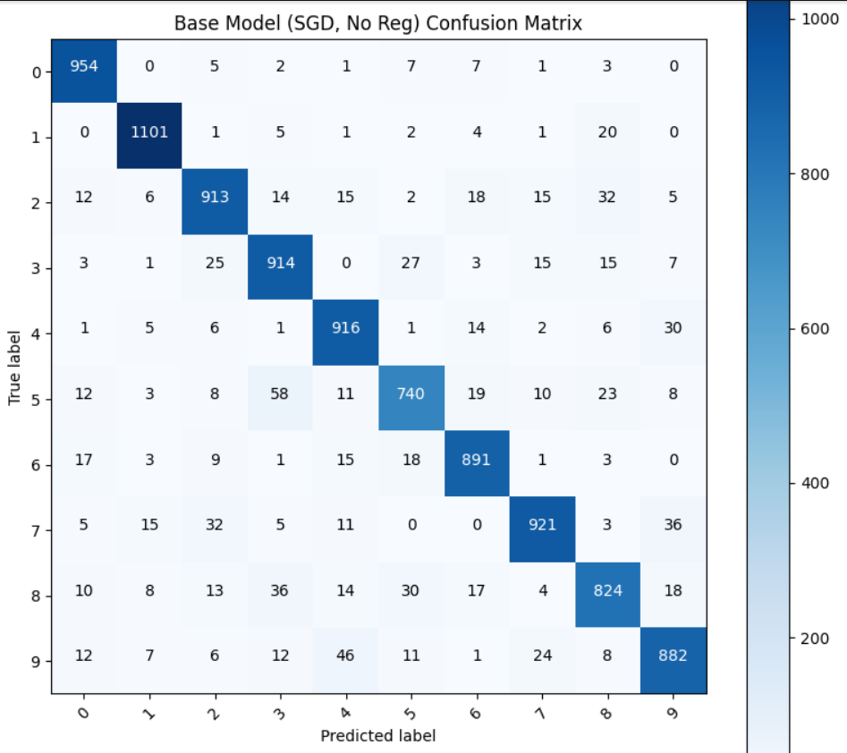
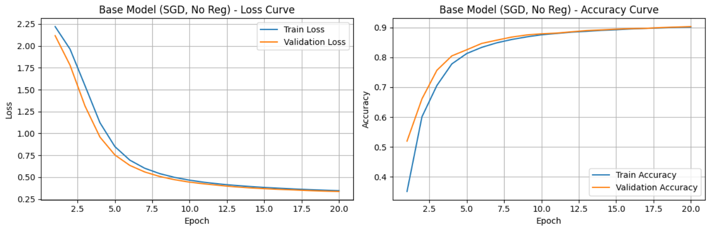
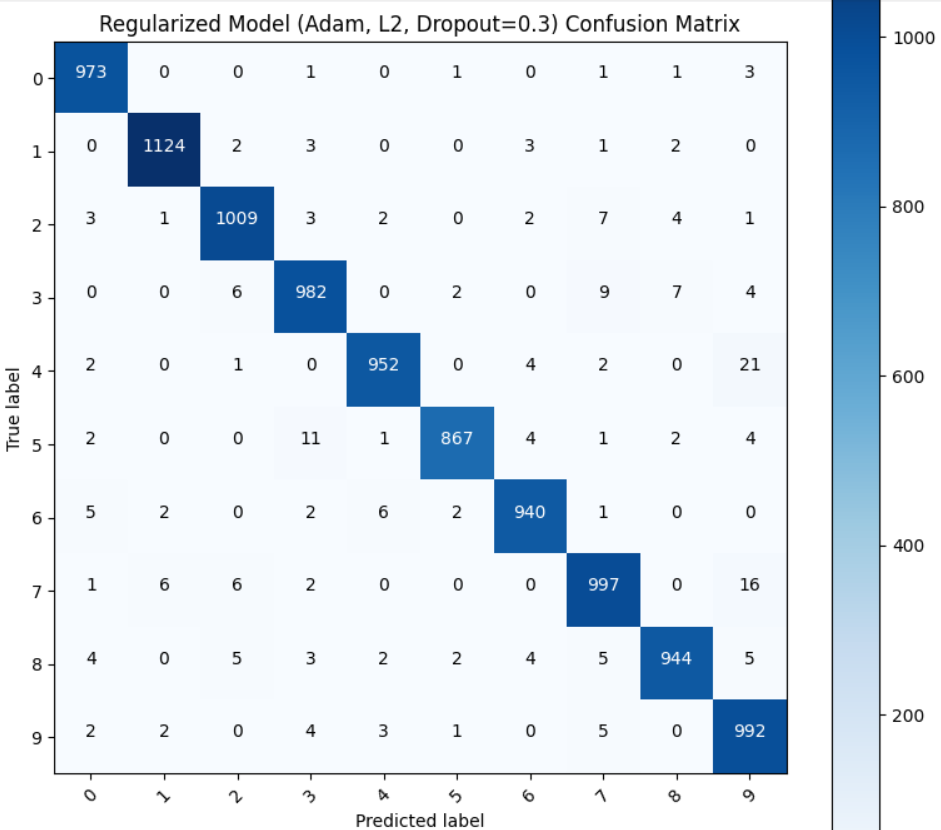
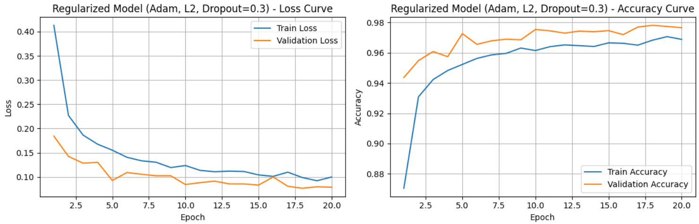
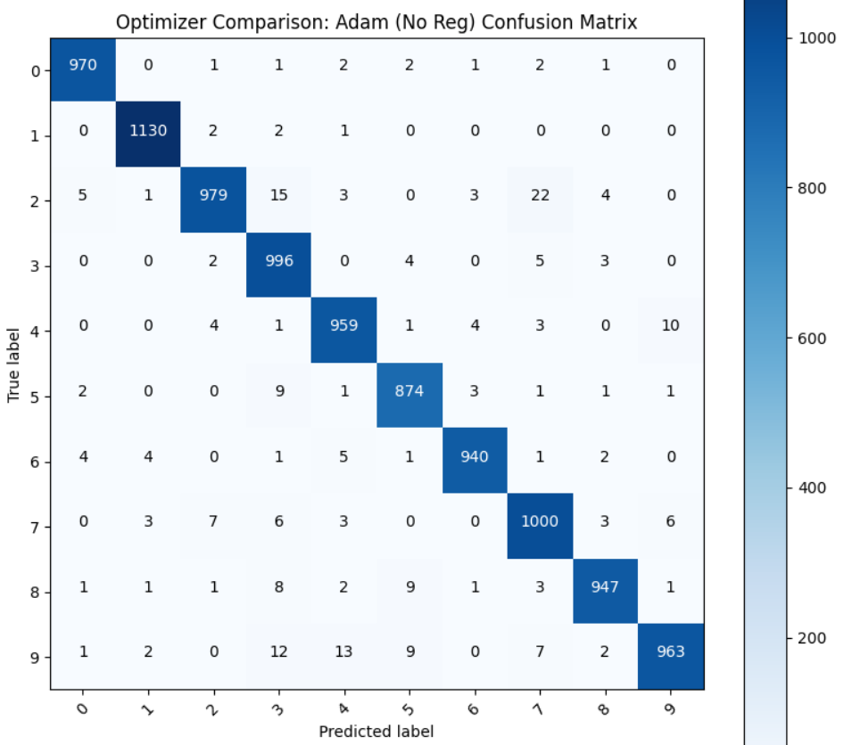
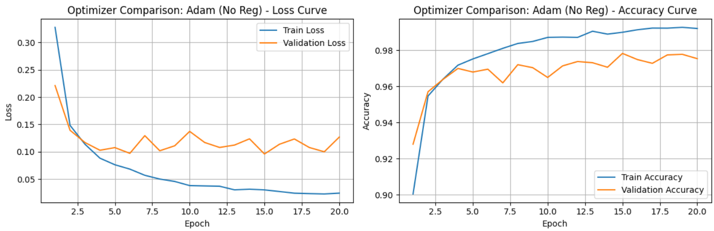
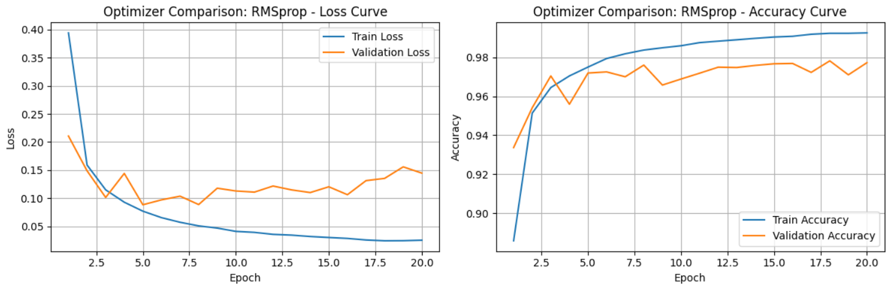

# MNIST Digit Classification with a Multilayer Perceptron

## Regularization and Optimizer Comparison

This project develops a fully connected neural network for classifying handwritten digits from the **MNIST dataset**. It examines the learning behavior of a baseline model, evaluates the effect of dropout and L2 regularization, and compares three optimization methods: SGD, Adam, and RMSprop.

## Problem Definition

MNIST digit recognition is a multiclass image-classification task. Each grayscale image represents one handwritten digit from `0` to `9`, and the model must assign it to the correct class.

The project focuses on three main questions:

- How effectively can a multilayer perceptron classify MNIST digits?
- How do dropout and L2 regularization affect learning and generalization?
- How do SGD, Adam, and RMSprop compare under the implemented configuration?

## Dataset and Preprocessing

The MNIST dataset is loaded through `torchvision.datasets.MNIST` and divided into training, validation, and test subsets.

| Subset | Number of samples |
|---|---:|
| Training | 48,000 |
| Validation | 12,000 |
| Test | 10,000 |

The original MNIST training set is randomly divided using an 80/20 split. The official MNIST test set is retained for final evaluation.

Each image is converted to a tensor and normalized using:

```text
mean = 0.5
standard deviation = 0.5
```

The normalized pixel value is therefore computed as:

$$
x' = \frac{x-0.5}{0.5}
$$

Data is processed in mini-batches of 64 samples. Training batches are shuffled, while validation and test batches preserve their order.

## Network Architecture

The model is a feed-forward multilayer perceptron implemented with PyTorch.

| Layer | Configuration |
|---|---|
| Input | Flattened `28 × 28` image = 784 features |
| Hidden layer 1 | 512 neurons + ReLU |
| Dropout layer 1 | Experiment-dependent dropout rate |
| Hidden layer 2 | 256 neurons + ReLU |
| Dropout layer 2 | Experiment-dependent dropout rate |
| Output | 10 logits, one for each digit class |

The forward pass is:

$$
\mathbf{x}\rightarrow\operatorname{Flatten}\rightarrow
\operatorname{Linear}(784,512)\rightarrow\operatorname{ReLU}\rightarrow
\operatorname{Dropout}\rightarrow
\operatorname{Linear}(512,256)\rightarrow\operatorname{ReLU}\rightarrow
\operatorname{Dropout}\rightarrow
\operatorname{Linear}(256,10)
$$

The model produces raw logits, and `CrossEntropyLoss` is used as the training objective.

## Training and Evaluation Procedure

All models are trained for 20 epochs with a learning rate of `0.001`. During each epoch, the implementation records:

- Training loss
- Validation loss
- Training accuracy
- Validation accuracy

The state associated with the highest observed validation accuracy is retained and loaded before the final training, validation, and test evaluations.

Model behavior is examined using:

- Final loss and accuracy on all three subsets
- Learning curves across epochs
- A confusion matrix on the test set
- The final train–validation loss and accuracy gaps

## Experiment 1 — Baseline Model

The baseline network uses stochastic gradient descent without dropout or weight decay.

| Setting | Value |
|---|---|
| Optimizer | SGD |
| Learning rate | 0.001 |
| Dropout | 0.0 |
| Weight decay | 0 |
| Epochs | 20 |

### Final Metrics

| Dataset | Loss | Accuracy |
|---|---:|---:|
| Training | 0.3435 | 0.9021 |
| Validation | 0.3371 | 0.9028 |
| Test | 0.3301 | 0.9056 |

### Confusion Matrix



The baseline model correctly classifies most test samples, but larger error concentrations appear for visually similar digits. In particular, digit `5` has the lowest diagonal count among the ten classes, while several `5` samples are predicted as `3`.

### Learning Curves



Both training and validation loss decrease consistently throughout the 20 epochs, while their accuracy curves rise together. The final validation loss is slightly lower than the training loss, and the two accuracies are almost identical.

| Generalization measure | Value |
|---|---:|
| Validation loss − training loss | -0.0064 |
| Training accuracy − validation accuracy | -0.0007 |

The close training and validation results indicate effective learning without visible severe overfitting. However, the low learning rate used with SGD results in slower convergence and substantially lower final accuracy than the adaptive optimizers.

## Experiment 2 — Regularized Model

The regularized network combines Adam optimization, dropout, and L2 regularization through weight decay.

| Setting | Value |
|---|---|
| Optimizer | Adam |
| Learning rate | 0.001 |
| Dropout | 0.3 |
| Weight decay | `1 × 10⁻⁴` |
| Epochs | 20 |

### Final Metrics

| Dataset | Loss | Accuracy |
|---|---:|---:|
| Training | 0.0414 | 0.9870 |
| Validation | 0.0790 | 0.9766 |
| Test | 0.0733 | 0.9780 |

### Confusion Matrix



The regularized model produces a strong diagonal across all classes. One of its most visible remaining confusions is between digits `4` and `9`, with 21 samples of digit `4` classified as `9`.

### Learning Curves



The model converges much faster than the baseline. Training loss falls steadily, while validation loss reaches a low range and then fluctuates moderately across later epochs. The validation accuracy remains close to the training accuracy despite these short-term changes.

| Generalization measure | Value |
|---|---:|
| Validation loss − training loss | 0.0376 |
| Training accuracy − validation accuracy | 0.0104 |

The relatively small final gaps indicate that dropout and L2 regularization maintain good generalization while allowing the model to reach considerably higher accuracy than the SGD baseline.

## Experiment 3 — Adam without Regularization

To separate the effect of the optimizer from the effect of regularization, a third model uses Adam without dropout or weight decay.

| Setting | Value |
|---|---|
| Optimizer | Adam |
| Learning rate | 0.001 |
| Dropout | 0.0 |
| Weight decay | 0 |
| Epochs | 20 |

### Final Metrics

| Dataset | Loss | Accuracy |
|---|---:|---:|
| Training | 0.0223 | 0.9928 |
| Validation | 0.1268 | 0.9754 |
| Test | 0.1139 | 0.9758 |

### Confusion Matrix



The model maintains high class-level performance, but errors remain among similar digits. Notable examples include confusion between `2` and `7`, and between `9` and digits such as `3` and `4`.

### Learning Curves



Adam reaches high accuracy rapidly, but validation loss becomes noticeably less stable in later epochs while training loss continues to decrease. This separation suggests stronger overfitting behavior than in the regularized model.

| Generalization measure | Value |
|---|---:|
| Validation loss − training loss | 0.1046 |
| Training accuracy − validation accuracy | 0.0174 |

Although its training accuracy is the highest among the Adam experiments, its test accuracy and test loss are weaker than those of the regularized model. This comparison demonstrates the benefit of dropout and L2 regularization for controlling the train–validation gap.

## Experiment 4 — RMSprop

The final experiment evaluates RMSprop without dropout or weight decay.

| Setting | Value |
|---|---|
| Optimizer | RMSprop |
| Learning rate | 0.001 |
| Dropout | 0.0 |
| Weight decay | 0 |
| Epochs | 20 |

### Final Metrics

| Dataset | Loss | Accuracy |
|---|---:|---:|
| Training | 0.0209 | 0.9939 |
| Validation | 0.1446 | 0.9772 |
| Test | 0.1285 | 0.9790 |

### Confusion Matrix


The RMSprop model achieves the highest test accuracy of the four reported experiments. Its confusion matrix shows strong diagonal values across every class, although some errors remain between digits `4` and `9`, and between `7` and `9`.

### Learning Curves



Training loss continues to decrease, but validation loss becomes increasingly variable across later epochs. The final loss gap is the largest among the evaluated models.

| Generalization measure | Value |
|---|---:|
| Validation loss − training loss | 0.1238 |
| Training accuracy − validation accuracy | 0.0166 |

RMSprop provides the highest test accuracy, but its higher test loss and wider train–validation loss gap indicate less stable probability estimates and stronger overfitting tendencies than the regularized model.

## Model Comparison

| Model | Optimizer | Regularization | Test Loss | Test Accuracy |
|---|---|---|---:|---:|
| Baseline | SGD | None | 0.3301 | 0.9056 |
| Regularized model | Adam | Dropout 0.3 + L2 | **0.0733** | 0.9780 |
| Adam comparison | Adam | None | 0.1139 | 0.9758 |
| RMSprop comparison | RMSprop | None | 0.1285 | **0.9790** |

RMSprop achieves the highest recorded test accuracy at **97.90%**, narrowly exceeding the regularized Adam model at **97.80%**. However, the regularized model achieves the lowest test loss and a substantially smaller train–validation loss gap. It therefore provides the strongest balance between predictive accuracy, loss, and generalization among the evaluated configurations.

The results also show that optimizer selection has a major effect under the shared learning rate: both Adam and RMSprop converge much faster and outperform the SGD baseline. Comparing the two Adam models further shows that dropout and L2 regularization slightly improve test accuracy, markedly reduce test loss, and limit the separation between training and validation performance.
