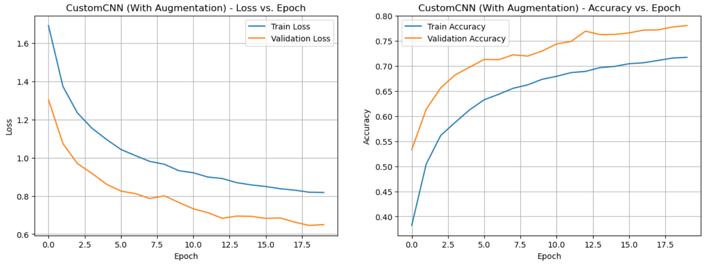
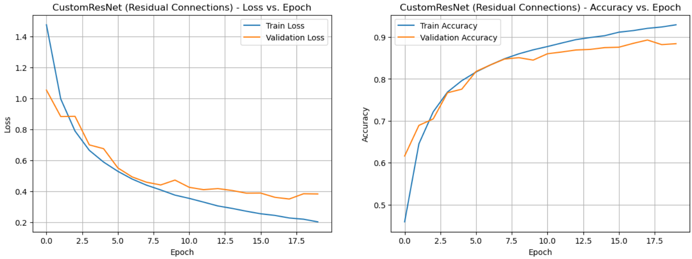
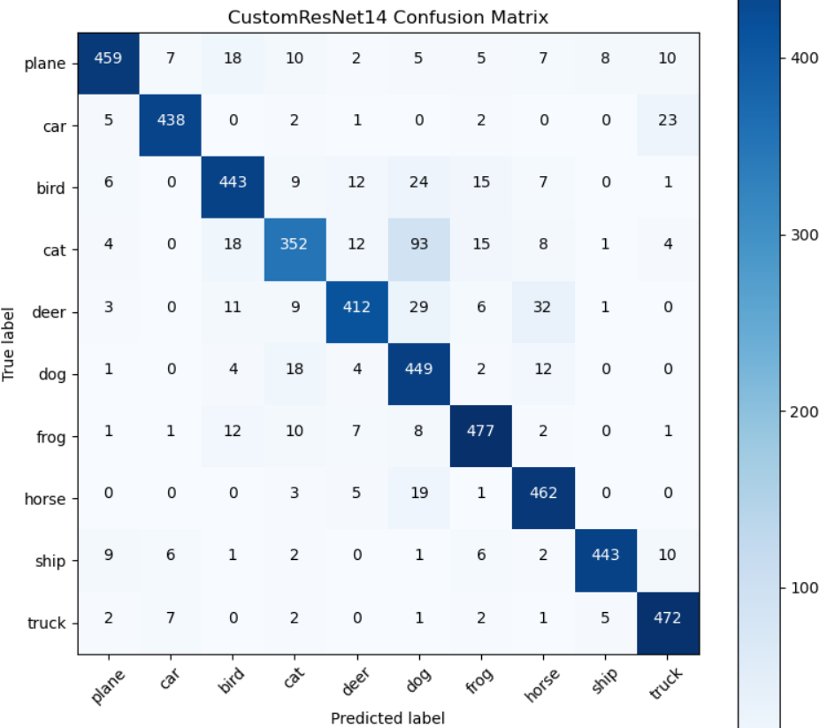
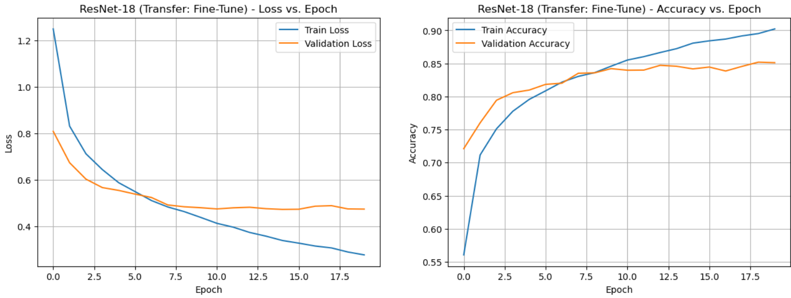

# CIFAR-10 Image Classification with CNNs and Transfer Learning

## Overview

This project investigates image classification on the **CIFAR-10 dataset** using convolutional neural networks. It compares a baseline CNN, data augmentation, a deeper CNN, a custom residual network, and three transfer-learning strategies based on a pretrained ResNet-18.

## Dataset and Preprocessing

CIFAR-10 contains `32 × 32` RGB images from ten classes: airplane, automobile, bird, cat, deer, dog, frog, horse, ship, and truck.

| Subset | Samples |
|---|---:|
| Training | 50,000 |
| Validation | 5,000 |
| Test | 5,000 |

All images are converted to tensors and normalized with a mean and standard deviation of `0.5` for each color channel. The augmented training pipeline additionally applies random cropping, horizontal flipping, and color jitter.

## Implemented Models

| Model | Main idea |
|---|---|
| Custom CNN | Two convolutional layers followed by a fully connected classifier |
| Custom CNN + augmentation | Baseline CNN trained with augmented images |
| Deep CNN | Additional convolutional layers, batch normalization, and dropout |
| Custom ResNet-14 | Residual blocks with skip connections and adaptive average pooling |
| ResNet-18 — frozen | Only the final classification layer is trained |
| ResNet-18 — partial freeze | Later residual layers and the classifier are trained |
| ResNet-18 — fine-tuned | All pretrained layers are updated |

The models use cross-entropy loss and Adam optimization. Most experiments are trained for 20 epochs; the fully frozen ResNet-18 experiment uses 5 epochs.

## Effect of Data Augmentation

Adding random transformations improves the baseline CNN test accuracy from **74.08%** to **76.82%** and reduces its test loss from `1.1492` to `0.6717`. The learning curves show that augmented training is more challenging, but produces better generalization.

## Custom Architectures

Increasing network depth raises test accuracy to **87.52%**. The custom ResNet-14 performs best overall at **88.14%**, showing the benefit of residual connections for training a deeper feature extractor.

The confusion matrix has a strong diagonal across all ten classes. Most remaining errors occur among visually similar animal classes, particularly cats and dogs, while vehicles such as automobiles, ships, and trucks are classified more reliably.

## Transfer Learning with ResNet-18

Three strategies are evaluated using a pretrained ResNet-18. Training only the final classifier performs poorly because features learned from ImageNet are not sufficiently adapted to the small CIFAR-10 images. Allowing later layers to update produces a large improvement, while full fine-tuning gives the strongest transfer-learning result.

## Model Comparison

| Model | Test loss | Test accuracy |
|---|---:|---:|
| Custom CNN | 1.1492 | 74.08% |
| Custom CNN + augmentation | 0.6717 | 76.82% |
| Deep CNN + augmentation | 0.3927 | 87.52% |
| **Custom ResNet-14** | **0.3887** | **88.14%** |
| ResNet-18 — frozen | 1.8488 | 37.52% |
| ResNet-18 — partial freeze | 0.6464 | 77.80% |
| ResNet-18 — fine-tuned | 0.4637 | 85.04% |

The custom ResNet-14 achieves the highest test accuracy and the lowest test loss. Among the transfer-learning approaches, full fine-tuning is the most effective, although it remains below the best model trained specifically for CIFAR-10.
