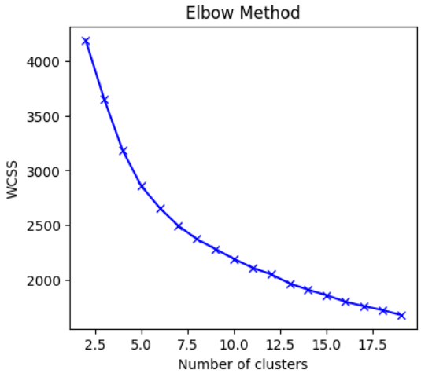
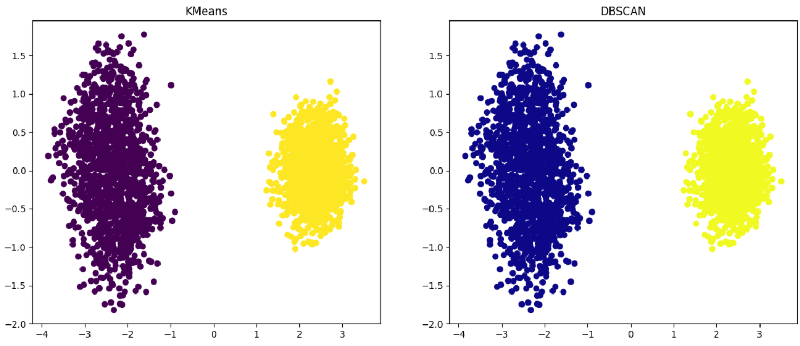

# Personality Clustering with K-Means and DBSCAN

This project applies two unsupervised learning algorithms, **K-Means** and **DBSCAN**, to behavioral data from a personality dataset. The objective is to identify natural groups without using the original `Personality` label and to compare the clustering structures produced by the two methods.

## Dataset

The dataset describes behavioral and social characteristics associated with introverted and extroverted personalities.

| Feature | Description |
|---|---|
| `Time_spent_Alone` | Time spent alone |
| `Stage_fear` | Whether the person experiences stage fear |
| `Social_event_attendance` | Frequency of attending social events |
| `Going_outside` | Frequency of going outside |
| `Drained_after_socializing` | Whether social interaction causes exhaustion |
| `Friends_circle_size` | Size of the person's social circle |
| `Post_frequency` | Frequency of posting on social media |

The `Personality` column is removed before clustering so that the algorithms operate only on the input features.

## Data Preprocessing

The preprocessing pipeline consists of the following steps:

1. Remove the target-like `Personality` column.
2. Convert `Yes` and `No` values in `Stage_fear` and `Drained_after_socializing` to `1` and `0`.
3. Replace missing numerical values with the mean of their corresponding columns.
4. Standardize all seven features using `StandardScaler`.

Standardization places features with different ranges on a comparable scale and prevents variables with larger numerical values from dominating the clustering process.

## K-Means Clustering

K-Means is evaluated for cluster counts from `2` to `19`. The implementation uses K-Means++ initialization, `10` initializations, and a fixed random state for reproducibility. Within-cluster sum of squares (WCSS) is recorded for each value of `k`.

### Elbow Method

The WCSS decreases continuously as the number of clusters increases, but the curve does not contain a sharply defined elbow. Based on the observed structure and the expected division of the data, `k = 2` is selected.

| K-Means setting | Value |
|---|---:|
| Number of clusters | 2 |
| Initialization | K-Means++ |
| Number of initializations | 10 |
| Silhouette score | 0.674 |
| Detected outliers | 0 |

## DBSCAN Clustering

DBSCAN is tested using epsilon values from `0.5` to `1.4` and `min_samples` values from `2` to `5`. The parameter combination with the highest silhouette score is selected.

| DBSCAN setting | Value |
|---|---:|
| Optimal epsilon | 1.2 |
| Optimal `min_samples` | 2 |
| Number of clusters | 2 |
| Silhouette score | 0.674 |
| Detected outliers | 0 |

## PCA Visualization

Principal Component Analysis is used to reduce the standardized seven-dimensional data to two dimensions for visualization.

Both visualizations show two clearly separated groups. K-Means and DBSCAN assign the observations to the same visible cluster structure, and DBSCAN does not identify any noise points under its selected parameters.

## Algorithm Comparison

| Metric | K-Means | DBSCAN |
|---|---:|---:|
| Number of clusters | 2 | 2 |
| Silhouette score | 0.674 | 0.674 |
| Outliers | 0 | 0 |

The two algorithms produce equivalent results for this dataset. The distinct two-group structure visible after PCA suggests that the discovered clusters likely correspond to the introvert and extrovert categories contained in the removed `Personality` column. This relationship is an interpretation of the clustering pattern; the code does not directly calculate agreement with the original labels.
